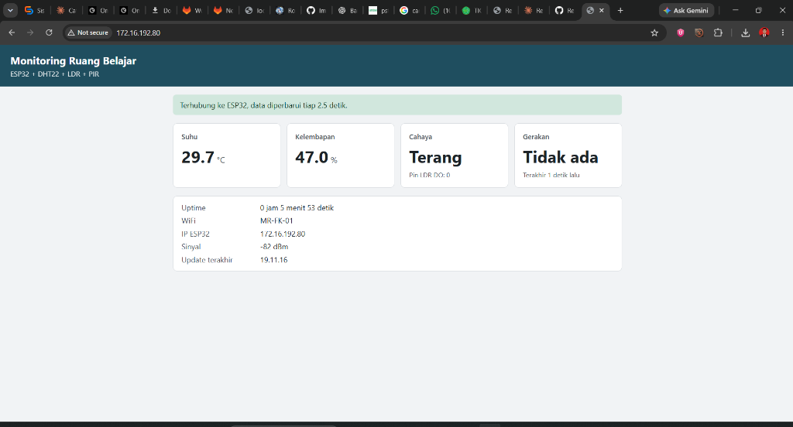

# Monitoring Ruang Belajar (ESP32 + DHT22 + LDR + PIR)

Proyek IoT untuk memantau kondisi ruang belajar. ESP32 membaca suhu, kelembapan, intensitas cahaya, dan gerakan, lalu menampilkannya di Serial Monitor dan di dashboard web yang disajikan langsung oleh ESP32. Data juga bisa dikirim ke ThingSpeak.

## Fitur

- Pembacaan suhu dan kelembapan (DHT22).
- Deteksi kondisi cahaya terang atau gelap (modul LDR, output digital).
- Deteksi gerakan (sensor PIR), termasuk waktu gerakan terakhir.
- Dashboard web yang diperbarui otomatis tiap 2,5 detik.
- Endpoint JSON di `/data`.
- Kirim data ke ThingSpeak tiap 20 detik (opsional).
- Reconnect WiFi otomatis.

## Perangkat Keras

| Komponen | Pin ESP32 |
|----------|-----------|
| DHT22    | GPIO 25   |
| LDR (DO) | GPIO 26   |
| PIR      | GPIO 27   |

## Struktur File

```
sketch_nov17a/
  sketch_nov17a.ino   Program utama (sensor, WiFi, web server, ThingSpeak)
  dashboard.h         HTML, CSS, dan JavaScript dashboard
docs/
  dashboard.png       Screenshot dashboard
```

## Library

- `DHT sensor library` (Adafruit) dan `Adafruit Unified Sensor`
- `ThingSpeak` (MathWorks)
- `WiFi` dan `WebServer` (sudah termasuk di board ESP32)

## Cara Menjalankan

1. Buka `sketch_nov17a/sketch_nov17a.ino` di Arduino IDE.
2. Isi `WIFI_SSID` dan `WIFI_PASSWORD` dengan WiFi Anda.
3. (Opsional) Isi `CHANNEL_ID` dan `WRITE_API_KEY` untuk ThingSpeak.
4. Upload ke ESP32 dengan baud rate Serial Monitor 115200.
5. Lihat IP ESP32 di Serial Monitor, lalu buka `http://<IP ESP32>` di browser.

> Laptop atau HP harus berada di jaringan WiFi yang sama dengan ESP32. Gunakan `http://`, bukan `https://`. Jika halaman tidak terbuka padahal satu WiFi, periksa apakah WiFi tersebut mengaktifkan client isolation. Hotspot HP biasanya tidak bermasalah.

## Hasil Serial Monitor

```
========================================
       MONITORING RUANG BELAJAR
========================================
Uptime           : 382 detik
----------------------------------------
Suhu             : 29.6 C
Kelembapan       : 47.4 %
----------------------------------------
Nilai LDR DO     : 0
Kondisi Cahaya   : TERANG
Gerakan          : TIDAK ADA
----------------------------------------
WiFi             : TERHUBUNG
IP ESP32         : 172.16.192.80
Sinyal           : -78 dBm
========================================
[ThingSpeak] Isi Channel ID dan API Key.
```

Pesan `[ThingSpeak] Isi Channel ID dan API Key.` muncul selama `CHANNEL_ID` dan `WRITE_API_KEY` belum diisi.

## Tampilan Dashboard



## Data ThingSpeak

| Field | Isi |
|-------|-----|
| 1 | Suhu (C) |
| 2 | Kelembapan (%) |
| 3 | Gelap (1) atau terang (0) |
| 4 | Gerakan terdeteksi (1) atau tidak (0) |

## Endpoint

| Alamat | Fungsi |
|--------|--------|
| `/` | Halaman dashboard |
| `/data` | Data sensor dalam format JSON |
